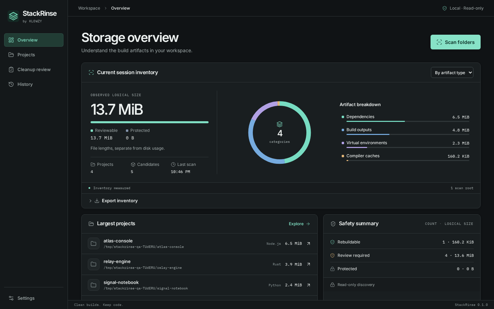

# StackRinse

**Clean builds. Keep code.**

StackRinse is an open-source developer storage workbench by KLOWZY. Choose a workspace to see how much of its logical storage goes to dependencies, build outputs, and caches. Find the largest projects and inspect artifact evidence before deciding what you might rebuild.



*Interface capture using a synthetic workspace and the browser test bridge.*

- **Measure.** Break down observed bytes by artifact type or ecosystem, with reviewable and protected totals.
- **Understand.** Explore detection evidence, rebuild implications, and project protection.
- **Compare.** Track comparable scans on this device and export inventory to JSON or CSV.

**First public alpha · v0.1.0-alpha.1.** StackRinse supports read-only discovery and dry-run review only. Actual cleanup, quarantine, restoration and permanent deletion are unavailable. Observed logical bytes measure file lengths and carry no guarantee of recoverable disk space. [Changelog](CHANGELOG.md) · [Alpha release notes](docs/releases/v0.1.0-alpha.1.md) · [Screenshot gallery](docs/visual-audit.md)

## Download and run on Windows

1. Open [GitHub Releases](https://github.com/KlowzyZ/StackRinse/releases) and download the alpha's Windows x64 portable ZIP and `SHA256SUMS.txt` when published.
2. Compare the ZIP hash with `SHA256SUMS.txt` using `Get-FileHash -Algorithm SHA256 <path-to-zip>`. Extract the ZIP.
3. Make sure Microsoft Edge WebView2 Evergreen Runtime is installed on your x64 Windows 10 or 11 machine. [Microsoft WebView2 Runtime](https://developer.microsoft.com/microsoft-edge/webview2/)
4. Open `StackRinse.exe`. The unsigned alpha may trigger a Windows reputation warning. Follow your organization's policy for unsigned applications.

The ZIP runs without an installer, development tools or a development server. Settings remain in `%APPDATA%\dev.klowzy.stackrinse` and scan history remains in `%LOCALAPPDATA%\dev.klowzy.stackrinse` for the current Windows user. Git is optional for discovery and is used to check index membership inside repositories.

The download targets Windows x64. For Linux and macOS, [build from source](#run-the-desktop-application). [Windows acceptance and packaging guide](docs/windows-preview.md)

## Try the CLI

Install stable Rust with Cargo, then run from the repository root. Replace `./projects` with a directory you want to inspect.

```sh
cargo run -p stackrinse-cli -- scan ./projects
cargo run -p stackrinse-cli -- scan ./projects --min-size 100MB
cargo run -p stackrinse-cli -- inspect ./projects --json
cargo run -p stackrinse-cli -- clean ./projects --dry-run
```

Use multiple roots to survey separate workspaces. Use `--exclude` to skip a directory and `--protect` to omit a project from planning. Use `--help` on a subcommand for its options. To put the binary on your Cargo path, run `cargo install --locked --path crates/stackrinse-cli`.

Exit statuses are 0 for a completed command, 1 for an operational error, 2 for invalid arguments, 3 for a scan with warnings and 130 for cancellation.

## Run the desktop application

Install stable Rust, Node.js 22.12 or newer with npm, and the [Tauri 2 prerequisites for your operating system](https://v2.tauri.app/start/prerequisites/). Linux requires WebKitGTK 4.1 development libraries. Windows uses the MSVC toolchain and WebView2. macOS development requires Xcode command-line tools.

```sh
cd apps/stackrinse-desktop
npm ci
npm run tauri dev
```

Choose a scan root in the desktop window. Review candidates by project and inspect their paths, evidence and rebuild consequences. The browser-only Vite server can display the interface. Filesystem access uses the native host.

Build locally with `npm run tauri build`. Dependency installation and initial builds require network access. Discovery runs locally.

## What discovery recognizes

| Project evidence | Examples of artifact evidence |
| --- | --- |
| Godot project (`project.godot`) | Godot 4 editor cache in `.godot/` containing both `.gdignore` and `imported/` |
| Go module (`go.mod`) | A vendored dependency directory containing a regular `modules.txt` |
| CMake project (`CMakeLists.txt`) | A conventional out-of-source build directory containing both `CMakeCache.txt` and `CMakeFiles/` |
| Node.js manifest | Package-manager metadata in `node_modules`, framework output markers in `.next` and `.nuxt` |
| Python manifest | `pyvenv.cfg` inside an environment, pytest cache marker, interpreter-named bytecode beside matching source |
| Python manifest | Ruff and mypy cache-tag signatures and each tool's generated ignore header |
| Dart Pub manifest (`pubspec.yaml`) | Paired package configuration and package graph in `.dart_tool` |
| Composer manifest (`composer.json`) | Installed-package metadata and both autoload entry files in `vendor` |
| Cargo manifest | Compiler metadata or cache tag in `target` |
| .NET project file | NuGet assets in `obj`, build configuration directories in `bin` |
| Maven or Gradle build file | Class or generator directories in the corresponding build output |
| Gradle build file | Project-local `.gradle` cache properties and binary output index |

Recognition uses filesystem structure, metadata, and bounded reads of known cache signatures. A valid-looking name can still contain hand edits. The engine checks Git index membership in repositories using a local Git installation and protects candidates when it cannot verify the index. When several ecosystems provide evidence for the same directory, its bytes appear once as mixed evidence and the directory is protected.

CMake discovery checks `build`, `cmake-build-debug` and `cmake-build-release`. A build-output directory containing its own `CMakeLists.txt` is left for project discovery. Go vendor trees and CMake builds require manual review.

## Interpreting results

A candidate's logical byte count describes the files observed during traversal. It can differ substantially from the storage the filesystem would release. Read the classification, detection evidence and rebuild implications before acting. A dependency installation can contain local modifications. The date shown for a project is the newest modification time among its recognized manifests.

The overview and CLI separate total, reviewable and protected logical bytes. JSON exposes them under `totals`. Reviewable bytes describe the maximum eligible dry-run selection for that report. A cancelled report has zero reviewable bytes.

A partial inventory counts only the file lengths the scanner observed. A protected candidate can show zero observed bytes when its contents were skipped. Protected candidates are excluded from dry-run totals. Project protection preferences can be removed in Settings. Git and filesystem boundaries still apply on the next scan.

The desktop **History** screen keeps finished scans on this device, including scans with incomplete inventories. Trends and comparisons use complete inventories with matching roots, exclusions, protection and discovery rules. A project move or rename can show up as a newly observed path and a path no longer observed. The Overview labels the current session inventory and the latest saved scan separately.

Use **History settings** to change retention or clear saved scans. **Export inventory** opens a native Save dialog for a JSON or CSV report from the current session or a saved scan. Reports may contain local filesystem paths, so review them before sharing.

See the [ecosystem coverage and evidence](docs/ecosystems.md), [filesystem safety model](docs/safety.md), [architecture](docs/architecture.md) and [roadmap](docs/roadmap.md).

## Development

```sh
cargo fmt --all -- --check
cargo test --locked  # shared core and CLI
cd apps/stackrinse-desktop
npm ci
npm run build
npx playwright install chromium
npm run test:e2e
cd ../..
cargo clippy --locked --workspace --all-targets -- -D warnings
cargo test --locked --workspace
cargo build --locked -p stackrinse-desktop --features custom-protocol
```

Run the [synthetic discovery benchmark](benchmarks/README.md) to measure traversal on your filesystem.

Contributions are welcome, especially small temporary fixtures that distinguish generated artifacts from similarly named user directories. See the [contributing guide](CONTRIBUTING.md), [community guidelines](CODE_OF_CONDUCT.md), and [security reporting instructions](SECURITY.md).

[MIT license](LICENSE) · KLOWZY
