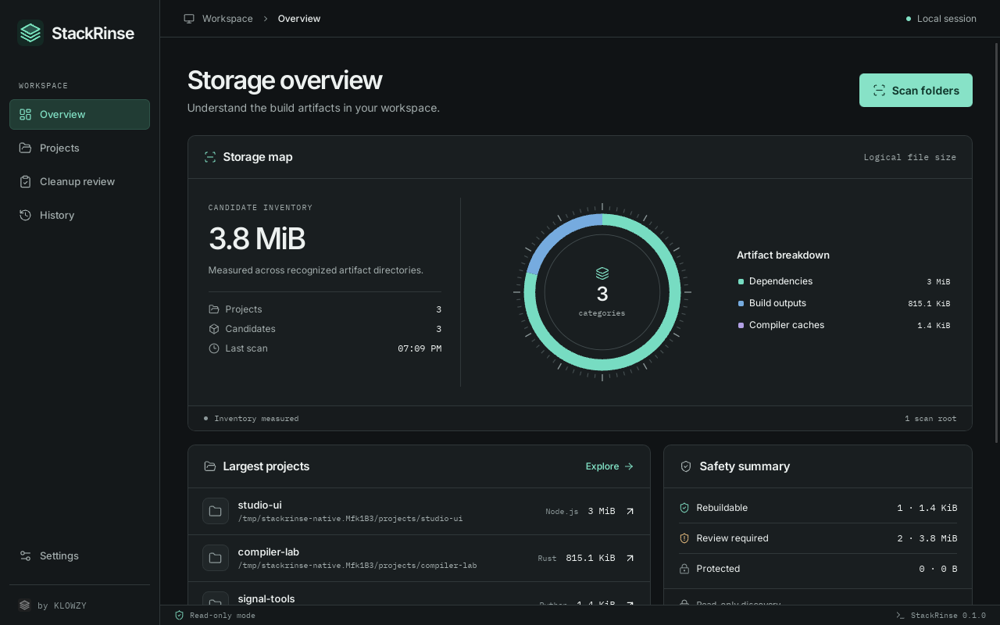

# StackRinse

**Clean builds. Keep code.**

StackRinse is an offline developer storage manager by KLOWZY. Point it at a workspace to inspect generated artifacts, compare their logical sizes, and see what each project would need to rebuild. The Rust CLI and desktop application share a read-only discovery engine. This development version previews cleanup.



## Try the CLI

Install stable Rust with Cargo, then run from the repository root. Replace `./projects` with a directory you want to inspect.

```sh
cargo run -p stackrinse-cli -- scan ./projects
cargo run -p stackrinse-cli -- scan ./projects --min-size 100MB
cargo run -p stackrinse-cli -- inspect ./projects --json
cargo run -p stackrinse-cli -- clean ./projects --dry-run
```

Use multiple roots to survey separate workspaces. Use `--exclude` to skip a directory and `--protect` to omit a project from planning. Use `--help` on a subcommand for its options. To put the binary on your Cargo path, run `cargo install --locked --path crates/stackrinse-cli`.

Exit statuses are 0 for a completed command, 1 for an operational error, 2 for invalid arguments, 3 for a scan with warnings and 130 for cancellation.

## Run the desktop application

Install stable Rust, Node.js 22.12 or newer with npm, and the [Tauri 2 prerequisites for your operating system](https://v2.tauri.app/start/prerequisites/). Linux requires WebKitGTK 4.1 development libraries. Windows uses the MSVC toolchain and WebView2. macOS development requires Xcode command-line tools.

```sh
cd apps/stackrinse-desktop
npm ci
npm run tauri dev
```

Choose a scan root in the desktop window. Review candidates by project and inspect their paths, evidence and rebuild consequences. The browser-only Vite server can display the interface. Filesystem access uses the native host.

Build locally with `npm run tauri build`. Dependency installation and initial builds require network access. Discovery runs locally.

## What discovery recognizes

| Project evidence | Examples of artifact evidence |
| --- | --- |
| Node.js manifest | Package-manager metadata in `node_modules`, framework output markers in `.next` and `.nuxt` |
| Python manifest | `pyvenv.cfg` inside an environment, pytest cache marker, interpreter-named bytecode beside matching source |
| Cargo manifest | Compiler metadata or cache tag in `target` |
| .NET project file | NuGet assets in `obj`, build configuration directories in `bin` |
| Maven or Gradle build file | Class or generator directories in the corresponding build output |

Recognition uses filesystem structure and metadata. A valid-looking name can still contain hand edits. The engine checks Git index membership in repositories using a local Git installation and protects candidates when it cannot verify the index.

## Interpreting results

A candidate's logical byte count describes the files observed during traversal. It can differ substantially from the storage the filesystem would release. Read the classification, detection evidence and rebuild implications before acting. A dependency installation can contain local modifications. A manifest timestamp offers limited evidence of activity.

See the [filesystem safety model](docs/safety.md), [architecture](docs/architecture.md) and [roadmap](docs/roadmap.md).

## Development

```sh
cargo test --workspace --locked
cargo fmt --all -- --check
cargo clippy --workspace --all-targets -- -D warnings
cd apps/stackrinse-desktop
npm ci
npm run build
npx playwright install chromium
npm run test:e2e
```

Run the [synthetic discovery benchmark](benchmarks/README.md) to measure traversal on your filesystem.

Contributions are welcome, especially small temporary fixtures that distinguish generated artifacts from similarly named user directories. See the [contributing guide](CONTRIBUTING.md), [community guidelines](CODE_OF_CONDUCT.md), and [security reporting instructions](SECURITY.md).

[MIT license](LICENSE) · KLOWZY
